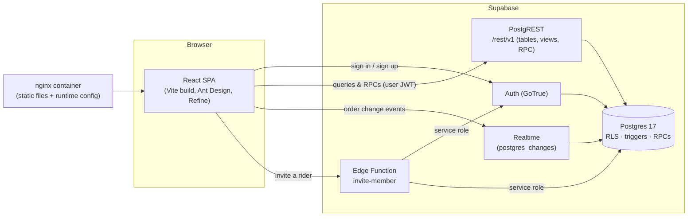
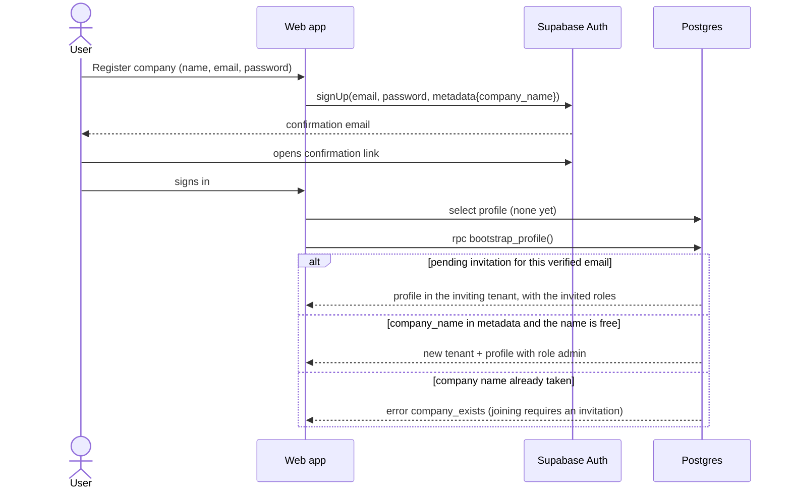
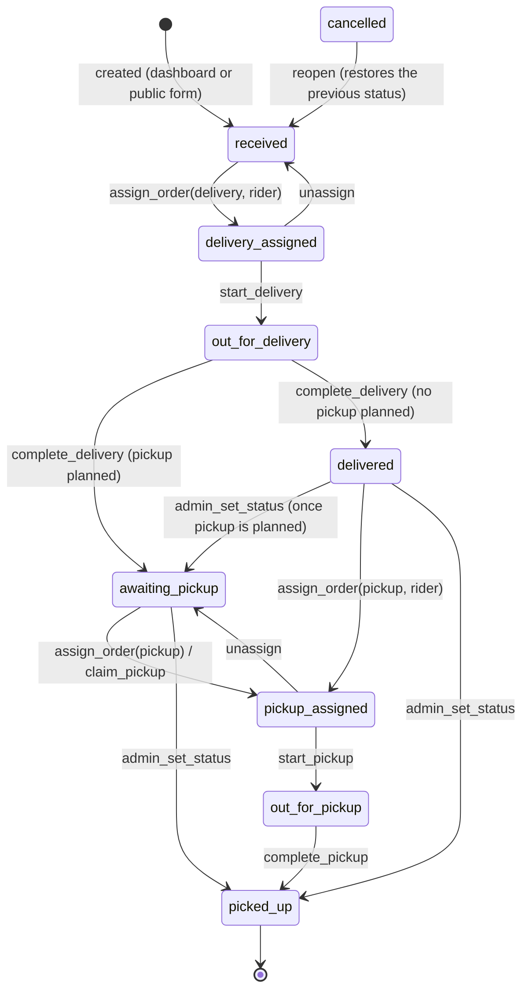

# Architecture

## Overview

There is **no custom application server**. The back end is Postgres plus a thin Edge Function:

- **All data access goes through PostgREST with the signed-in user's JWT.** Row Level Security
  decides what each user can read or write.
- **Business rules live in the database** (constraints, triggers, `SECURITY DEFINER` RPCs), so every
  client (this web app, a mobile app, a script) gets the same guarantees.
- **The one thing that cannot run in a browser**, sending an invitation email with the Auth admin
  API, is an Edge Function (`supabase/functions/invite-member`).

## Multi-tenancy

Every business table has a `tenant_id`. A user belongs to exactly one tenant (`profiles.tenant_id`).
RLS policies compare `tenant_id` with `private.current_tenant_id()`, so a company can never read or
write another company's rows, even by guessing ids. Triggers additionally verify that guides and
riders referenced by an order belong to the same tenant.

## Roles

| Role | Can |
|---|---|
| `admin` | Everything inside their company: orders, riders, guides, settings, dashboard, invitations |
| `rider` | Read orders assigned to them plus unassigned pickups; move them forward via `rider_order_action` |
| anonymous | Only `get_public_tenant` and `create_public_order` (the public booking form) |

A person may hold both `admin` and `rider`. **Guides are not users**: they are contact records
(`guides`) used to pre-fill orders.

## Sign-up and onboarding

Profiles are created lazily by `public.bootstrap_profile()` the first time a **confirmed** user signs
in (there is no trigger on `auth.users`, so a failed signup can never leave half-created data):

Invitations: an admin calls the `invite-member` Edge Function, which stores a row in
`invitations` and asks Auth to email an invite link to `/join`. The invitee chooses a password;
`bootstrap_profile()` matches the invitation on the verified email.

## Order lifecycle

An order has a **delivery leg** and an optional **pickup leg**, each with its own rider.

Any open order can be cancelled by an admin. Rules worth knowing:

- **Status and riders can only change through RPCs** (`assign_order`, `admin_set_status`,
  `rider_order_action`). A trigger rejects direct `UPDATE`s of those columns, even for admins.
- A leg that is *in progress or finished* cannot be reassigned.
- A pickup rider can only be assigned once the pickup has a time **and** an address.
- Every change is written to `order_events` (who, what, when), shown as the timeline in the order drawer.

### Radio channels

Channels are numbered `0 … tenants.radio_channels_total`. A channel is **busy** while an order that
holds it is open (any status except `picked_up` / `cancelled`). A partial unique index makes
double-booking impossible, and `get_channel_status()` returns the live state of every channel.
The only manual setting is `tenants.disabled_channels`.

## Realtime

The Orders, Team and rider screens subscribe to `postgres_changes` on `public.orders` (RLS is applied
to the change stream) and refetch their queries when something changes, so two admins and a rider
all see the same state without refreshing.

## Time zones

Timestamps are stored as `timestamptz`. Day, week and month boundaries, the calendar and the
dashboard statistics are computed in the **company's time zone** (`tenants.timezone`, default
`Europe/Rome`), not in the browser's. Date pickers show wall-clock time in that zone.

## Front-end structure

- **Refine** is used headless: auth provider, access control, routing glue. `@refinedev/antd` is not
  used (it only supports Ant Design 5); the layout, notifications and 404 page are local code.
- **Server state** is TanStack Query (`features/*/hooks.ts`); each feature has a small typed API
  module (`features/*/api.ts`) over supabase-js. No component talks to Supabase directly except auth.
- **Domain rules shared with the database** (assignable leg, selectable channels, status actions) are
  plain functions with unit tests (`src/types/domain.ts`, `features/orders/orderActions.ts`).
- Heavy screens (dashboard, calendar, team, …) are lazy-loaded; jsPDF is only loaded when exporting.

## Configuration at runtime

Vite inlines `import.meta.env` at build time. To ship **one Docker image for every environment**, the
container writes `window.__ENV__` (from environment variables) into `/env-config.js` at start;
`src/config/env.ts` reads that first and falls back to `import.meta.env`.

## Security notes

- The anon key is public by design; **RLS is the security boundary**. Never ship the service-role key
  to the browser (only the Edge Function has it).
- Privileged columns (`roles`, `disabled`, `tenant_id`) are not writable by users; admins change them
  through `update_member`, which also protects the last admin and refuses to disable a rider with open work.
- `create_public_order` validates all input and throttles per phone number (5/hour) and per tenant
  (200/hour). For stronger protection add a CAPTCHA in front of it.
- The nginx image runs as a non-root user with a read-only root filesystem (see `docker-compose.yml`).
- Not included yet: a full Content-Security-Policy (Google Maps and Ant Design's runtime styles need a
  tailored policy). Only `frame-ancestors`, `object-src` and `base-uri` are set.
