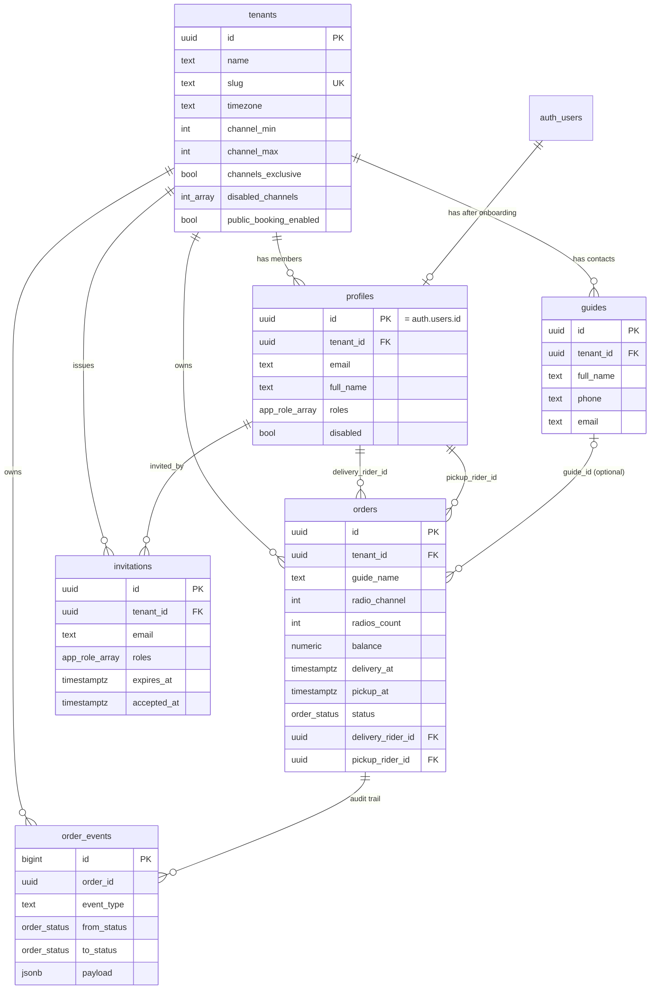

# Database

The schema lives in `supabase/migrations/` (apply order = file name order):

| File | Contents |
|---|---|
| `…000000_init_schema.sql` | enums, tables, indexes, constraints |
| `…000100_functions_triggers.sql` | identity helpers, order guard trigger, audit trigger |
| `…000200_rls.sql` | RLS policies, grants, realtime publication |
| `…000300_rpcs.sql` | business RPCs, `rider_activity` view, dashboard stats, public booking |
| `…000400_bootstrap_profile_lock.sql` | makes `bootstrap_profile()` safe under concurrent first-login calls (advisory lock) |
| `20261119000000_contact_messages.sql` | `contact_messages` for the landing-page contact form (service role only, written by the `contact` Edge Function) |
| `20261120000000_channels_any_range.sql` | channel range 1–10,000 per company, time-based channel conflicts, `get_channel_board` |
| `20261130000000_channel_hold_until_freed.sql` | a channel stays occupied until its order is picked up or cancelled (`channel_hold`), `overdue` on the board |
| `20261201000000_rider_shifts.sql` | rider availability, hourly shifts (with the planned times and a history), staffing needs, hours report, RPCs ([SHIFTS.md](SHIFTS.md)) |

| `20261120010000_platform_console.sql` | private platform operators, configuration, plans, subscriptions, payments, issues and audit, plus MFA-checked RPCs |
| `20261120010100_platform_access.sql` | operator invitation acceptance, ownership guard and subscription access enforcement |

Tests: `supabase/tests/database.test.sql` and `supabase/tests/platform.test.sql` (pgTAP, run with `supabase test db`).

## Production records and cutover audit

The migrations create the structure but insert zero business rows on a fresh database. The channel migration only backfills companies that already exist. Supabase initializes its own system schemas. Leave `supabase/seed.sql` out of production because it creates a demo company, demo passwords and synthetic orders.

| Records | Fresh install | Existing EchoBox data |
|---|---|---|
| `auth.users`, `auth.identities` | Supabase Auth creates accounts and sign-in identities. Register and confirm the first real admin through the app. | Preserve its Auth records when restoring an existing Supabase deployment. If moving from Firebase, map each old staff UID to the new Supabase user UUID before linking business records. |
| `tenants` | First verified sign-in creates one company with a unique name and booking slug. Verify its time zone, booking switch and equipment settings. | Keep company UUIDs and slugs for a Supabase restore. For Firestore, resolve and map company IDs and set the actual time zone, channel configuration and booking state for each company. |
| `profiles` | `bootstrap_profile()` creates a profile for the first admin and each later user who joins by invitation. The profile ID equals the Auth user ID. | Restore roles, company, contact fields and disabled state. Each profile belongs to one company and has `admin`, `rider`, or both. Each active company needs a verified, enabled admin account. |
| `guides` | Starts empty. The office can add contacts. Public booking looks up a guide by normalized phone within the company and creates a contact when needed. | Import real contacts and deduplicate nonempty phone and email keys within each company. Guide-only Firebase users become contacts. Keep historical guide text on each order. |
| `orders` | Starts empty. The office or the company's public booking link creates rows. | Restore upcoming work and the retained history, including cancelled orders. Preserve tenant, status, assigned riders, the scheduled and actual timestamps that exist, addresses, equipment counts, balance, invoice flag, source and notes. |
| `invitations` | Starts empty. `invite-member` creates rows, and the verified user's bootstrap marks the matching invitation accepted. | Keep the useful history from Supabase and reissue outstanding links for the new host. For Firebase, reissue pending invitations through the app using the intended company and role. |
| `order_events` | Starts empty. The order audit trigger writes events, including a snapshot on deletion. | Preserve existing Supabase events, including rows whose order was deleted. An event that records the status before cancellation lets the app restore that status on reopening. A Firestore import cannot recover change history that was never recorded. |
| `contact_messages` | Starts empty. The optional landing contact function writes it using `service_role`. Rows are global to EchoBox. | Restore outstanding messages and any retained history, with handled and delivery status. Normal tenant users have no access to this inbox. |

For a fresh onboarding, the first working admin requires one confirmed Auth user with its sign-in identity, one company, and the matching admin profile. Creating an Auth account alone leaves it without an EchoBox company until onboarding succeeds. A second company needs its own admin. The app computes `rider_activity`, channel occupancy, and dashboard totals from existing records. Channel settings live on the company, and the app tracks quantities on orders. The superadmin panel, multi-company memberships, owner role and supervisor role are still described in the [backlog](TODO.md).

### Data checks before serving live traffic

- **Identity.** Check email confirmation, active admin access and the Auth UUID-to-profile mapping. Review confirmed accounts without a profile, which can include users who have yet to finish joining. Resolve pending invites for the same email across companies because the current bootstrap chooses the newest valid invitation. Reissue invites for people who still need access. A user with an existing profile already has their company assignment.
- **Company.** Keep previously shared booking slugs, confirm the actual `Europe/Rome` or other IANA time zone, and check `is_active` and `public_booking_enabled` for each company. New companies default to channels `1–40` with exclusive use. Companies already present before the channel migration keep their `0–previous maximum` range. Select channels and disabled values from the actual equipment inventory. `is_active` currently gates public booking.
- **Orders.** The database requires a tenant, a guide name of at least two characters, a delivery timestamp and a delivery address. For usable pickup work include both pickup timestamp and address. Assigned and in-progress legs need the matching same-company rider. Check rider access, pickup ordering, actual completion times, counts and any historic missing values against the source. Pass optional fields as null when the source has no value and the target permits it. Preserve original timestamps where available because direct insertion of a historical delivered or collected status can otherwise stamp the import time.
- **Channels.** Check open orders against each company's range, disabled list and exclusivity. Exclusive windows run from delivery to pickup or local midnight, with a one-minute minimum. Historical rows can refer to channels no longer in use, so test a cross-system import against the current guard before cutover.
- **Reconciliation.** Compare source and target row counts and order status totals per company and source. Compare radio and balance totals, check a sample of future jobs and completed orders, then test sign-in, booking, pickup and Realtime. For a Firestore source, use the [legacy field mapping and migration notes](MIGRATION_FROM_FIREBASE.md#data-model-mapping).

The [read-only data audit](../deploy/supabase/check-data.sql) reports counts, order totals by company/status/source, and anomalies without returning personal contact fields. Review nonzero checks against the source and expected onboarding state. The [deployment instructions](DEPLOYMENT.md#3-load-and-audit-the-echobox-database) show how to run it inside the EchoBox database container.

## Entity relationship diagram



## Enums

| Type | Values |
|---|---|
| `app_role` | `admin`, `rider` |
| `order_status` | `received`, `delivery_assigned`, `out_for_delivery`, `delivered`, `awaiting_pickup`, `pickup_assigned`, `out_for_pickup`, `picked_up`, `cancelled` |
| `order_source` | `dashboard`, `public_form` |

## Tables

### `tenants`
One row per company. `name_key` (lower-cased, trimmed name) is unique, so company names cannot be
claimed twice. `slug` is the public booking identifier (`/book/<slug>`).
`channel_min..channel_max` is the company's channel range (any equipment, at most 10,000 channels);
`disabled_channels` lists unusable ones (kept sorted, unique and inside the range by
`tenants_channel_guard`, which also refuses to drop or disable a channel an open order uses);
`channels_exclusive` says whether a channel serves one group at a time.

### `profiles`
Platform users, 1:1 with `auth.users`. `roles` must contain at least one role. Users can update only
`full_name`, `phone` and `avatar_url`; everything else goes through RPCs. Deleting a rider is not
supported: set `disabled` instead (orders keep referencing the rider).

### `guides`
Contacts (tour guides / groups). Unique per tenant on normalised phone digits and on email.

### `invitations`
Invitations are written by the Edge Function using `service_role`. Admins can read and revoke them. A pending record is unique per company and normalized email, and expires after seven days. The record stays in the table with `accepted_at` set when consumed.

### `orders`
| Column | Notes |
|---|---|
| `guide_id`, `guide_name`, `guide_phone`, `guide_email` | name is denormalised on purpose (manual entries / public bookings may have no contact row) |
| `radio_channel` | `>= 0`; validated against the tenant range and disabled list by trigger |
| `radios_count`, `extra_radios`, `lost_radios` | `>= 0` |
| `balance`, `invoice_required` | `numeric(10,2)` for the balance (formerly `saldo`) and a boolean invoice flag |
| `delivery_at`, `delivery_address`, `delivery_rider_id`, `delivered_at` | delivery leg |
| `pickup_at`, `pickup_address`, `pickup_rider_id`, `picked_up_at` | pickup leg (optional) |
| `status`, `source`, `notes`, `created_by` | |

Constraints:

- `pickup_at >= delivery_at`
- `delivery_assigned` / `out_for_delivery` require `delivery_rider_id`; `pickup_assigned` / `out_for_pickup` require `pickup_rider_id`
- an open order occupies its channel from `delivery_at` to `pickup_at` (or the end of the delivery day
  without a pickup) and, once that time has passed without the order being closed, until it is picked up
  or cancelled (`private.channel_hold`); with `channels_exclusive`, two open orders on the same channel
  cannot overlap in time (checked by `orders_guard` under a per-channel advisory lock)

### `order_events`
Append-only audit log filled by a trigger: `created`, `status_changed`, `assigned`, `updated`,
`deleted` (with a snapshot). Admins can read it.

### `contact_messages`
Each message has a name, email and message body. Company, phone, locale, IP hash and user agent are optional. `emailed_at` or `email_error` records notification delivery, and `handled` tracks whether the operator has handled the message.

### Rider shifts
`rider_availability`, `rider_shifts`, `rider_shift_events` and `shift_needs`: see [SHIFTS.md](SHIFTS.md). Readable with RLS (riders see their own
availability and shifts, admins the company; history and needs are admin-only), written only through the RPCs.

## View: `rider_activity`
`security_invoker` view: one row per active rider with `is_busy`, `in_progress`, `active_orders`,
`current_order_id`, `current_leg`, `current_status`, `heading_to`, `scheduled_at`, `last_activity_at`.
It replaces the old hand-maintained `rider_status` collection, which drifted out of sync.

## Triggers

| Trigger | Purpose |
|---|---|
| `orders_guard` (before insert/update) | blocks direct changes of status/riders (only the RPCs may), checks same-tenant references, validates the channel, stamps `delivered_at` / `picked_up_at` |
| `orders_audit` (after insert/update/delete) | writes `order_events` |
| `*_set_updated_at` | maintains `updated_at` |

The RPCs open a transaction-local gate (`set_config('app.order_actions', 'on', true)`) that
`orders_guard` honours. Nothing else can set it from the outside in a way that survives the transaction.

## Row Level Security

`✓` = allowed, `own` = only their own rows, `–` = no access. All rows are additionally limited to the caller's tenant.

| Table | anon | rider | admin |
|---|---|---|---|
| `tenants` | – | read | read, update (name, description, timezone, channels, booking toggle) |
| `profiles` | – | read own, update own (name/phone/avatar) | read all in tenant; changes via `update_member` |
| `guides` | – | – | full CRUD |
| `invitations` | – | – | read, delete (create via Edge Function) |
| `orders` | – | read assigned + unassigned `awaiting_pickup`; act via `rider_order_action` | full CRUD (status/riders via RPCs) |
| `order_events` | – | – | read |
| `contact_messages` | – | – | – |
| `rider_activity` (view) | – | own row | all riders in tenant |

Privileges are granted explicitly (`revoke all … from anon, authenticated` first), including
column-level grants for `tenants` and `profiles` updates.

## RPC reference

All are `SECURITY DEFINER` with `search_path = ''`. Errors are short codes (the web app translates them);
authorisation failures use SQLSTATE `42501`. See [API.md](API.md) for request examples.

| Function | Caller | What it does |
|---|---|---|
| `bootstrap_profile()` | signed-in | Creates the caller's profile: accept invitation, or register a new company |
| `touch_login()` | signed-in | Updates `last_login_at` |
| `update_member(user, name, phone, roles, disabled)` | admin | Edit a member; keeps ≥ 1 admin; refuses to disable a rider with open orders |
| `assign_order(order, leg, rider)` | admin | Assign / unassign a rider to the `delivery` or `pickup` leg |
| `admin_set_status(order, status)` | admin | Cancel, re-open, or move an order forward manually |
| `rider_order_action(order, action, lost)` | rider | `claim_pickup`, `start_delivery`, `complete_delivery`, `start_pickup`, `complete_pickup` |
| `get_channel_board(from, to)` | admin | Open orders holding a channel during the period, with `busy_until` (`null` = until the order is closed) and `overdue` (planned pickup passed, radios not returned) |
| `get_dashboard_insights(month)` | admin | The dashboard's figures for a month (and the 12 months around it), in the tenant time zone: revenue and quality against the previous period, capacity, alerts, rider workload, guides, lead time, locations |
| `save_availability`, `admin_save_shift`, `admin_delete_shift`, `admin_create_shifts`, `admin_cover_from_availability`, `get_rider_hours`, `admin_save_need`, `admin_delete_need`, `admin_copy_needs` | rider / admin | Availability, shifts, staffing needs and the hours report; see [SHIFTS.md](SHIFTS.md) |
| `get_public_tenant(slug)` | anon | Company name, time zone and whether bookings are open |
| `create_public_order(...)` | anon | Public booking: validates, throttles, upserts the guide, creates the order |

### Error codes

`company_exists`, `no_company`, `email_not_confirmed`, `last_admin`, `rider_has_active_orders`,
`member_not_found`, `order_not_found`, `order_cancelled`, `rider_invalid`, `delivery_not_reassignable`,
`pickup_not_assignable`, `pickup_details_missing`, `transition_not_allowed`, `use_assign_order`,
`order_not_claimable`, `invalid_lost_count`, `unknown_action`, `booking_unavailable`,
`invalid_guide_name`, `invalid_phone`, `invalid_radios_count`, `invalid_delivery_time`,
`invalid_pickup_time`, `invalid_address`, `too_many_requests`, `channel_busy`, `channel_out_of_range`,
`channel_disabled`, `channel_used_by_open_order`, `channel_conflicts_exist`; shifts: see [SHIFTS.md](SHIFTS.md#data).

## Working with migrations

```bash
npx supabase migration new <name>     # create supabase/migrations/<timestamp>_<name>.sql
npm run db:reset                      # re-apply everything + seed locally
supabase test db                      # run the pgTAP tests
npm run db:types                      # regenerate src/types/database.types.ts
supabase db push                      # apply to the linked remote project
```

Never edit a migration that has been applied to a shared database; add a new one (as `…000400` did). (The initial four were
edited in place during development because nothing had been deployed.)

> The generated types mark every column of a `returns table` function as non-null. Where that is wrong
> (`get_channel_board`: `pickup_at` can be null), the hand-written type in `src/types/domain.ts` is used instead.
