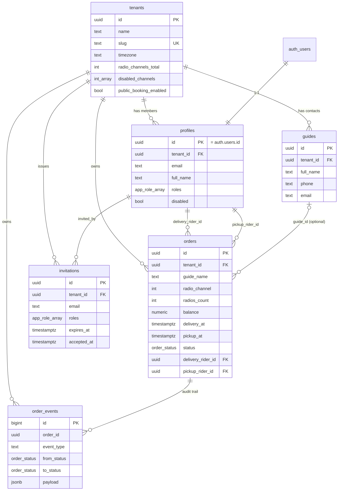

# Database

The schema lives in `supabase/migrations/` (apply order = file name order):

| File | Contents |
|---|---|
| `…000000_init_schema.sql` | enums, tables, indexes, constraints |
| `…000100_functions_triggers.sql` | identity helpers, order guard trigger, audit trigger |
| `…000200_rls.sql` | RLS policies, grants, realtime publication |
| `…000300_rpcs.sql` | business RPCs, `rider_activity` view, dashboard stats, public booking |
| `…000400_bootstrap_profile_lock.sql` | makes `bootstrap_profile()` safe under concurrent first-login calls (advisory lock) |
| `20261119000000_contact_messages.sql` | `contact_messages` for the landing-page contact form (service role only, written by the `contact` Edge Function) |

Tests: `supabase/tests/database.test.sql` (pgTAP, run with `supabase test db`).

## Entity relationship diagram



## Enums

| Type | Values |
|---|---|
| `app_role` | `admin`, `rider` |
| `order_status` | `received`, `delivery_assigned`, `out_for_delivery`, `delivered`, `awaiting_pickup`, `pickup_assigned`, `out_for_pickup`, `picked_up`, `cancelled` |
| `order_source` | `dashboard`, `public_form` |

## Tables

### `tenants`
One row per company. `name_key` (lower-cased, trimmed name) is unique, so company names cannot be
claimed twice. `slug` is the public booking identifier (`/book/<slug>`).
`radio_channels_total` defines channels `0..N` (inclusive); `disabled_channels` lists unusable ones.

### `profiles`
Platform users, 1:1 with `auth.users`. `roles` must contain at least one role. Users can update only
`full_name`, `phone` and `avatar_url`; everything else goes through RPCs. Deleting a rider is not
supported: set `disabled` instead (orders keep referencing the rider).

### `guides`
Contacts (tour guides / groups). Unique per tenant on normalised phone digits and on email.

### `invitations`
Pending invitations. Written by the Edge Function (service role); admins can read and revoke them.
One pending invitation per `(tenant, email)`. They expire after 7 days.

### `orders`
| Column | Notes |
|---|---|
| `guide_id`, `guide_name`, `guide_phone`, `guide_email` | name is denormalised on purpose (manual entries / public bookings may have no contact row) |
| `radio_channel` | `>= 0`; validated against the tenant range and disabled list by trigger |
| `radios_count`, `extra_radios`, `lost_radios` | `>= 0` |
| `balance`, `invoice_required` | `numeric(10,2)`; the old field was called `saldo` |
| `delivery_at`, `delivery_address`, `delivery_rider_id`, `delivered_at` | delivery leg |
| `pickup_at`, `pickup_address`, `pickup_rider_id`, `picked_up_at` | pickup leg (optional) |
| `status`, `source`, `notes`, `created_by` | |

Constraints:

- `pickup_at >= delivery_at`
- `delivery_assigned` / `out_for_delivery` require `delivery_rider_id`; `pickup_assigned` / `out_for_pickup` require `pickup_rider_id`
- **unique `(tenant_id, radio_channel)` while the order is open** (status not `picked_up`/`cancelled`)

### `order_events`
Append-only audit log filled by a trigger: `created`, `status_changed`, `assigned`, `updated`,
`deleted` (with a snapshot). Admins can read it.

## View: `rider_activity`
`security_invoker` view: one row per active rider with `is_busy`, `in_progress`, `active_orders`,
`current_order_id`, `current_leg`, `current_status`, `heading_to`, `scheduled_at`, `last_activity_at`.
It replaces the old hand-maintained `rider_status` collection, which drifted out of sync.

## Triggers

| Trigger | Purpose |
|---|---|
| `orders_guard` (before insert/update) | blocks direct changes of status/riders (only the RPCs may), checks same-tenant references, validates the channel, stamps `delivered_at` / `picked_up_at` |
| `orders_audit` (after insert/update/delete) | writes `order_events` |
| `*_set_updated_at` | maintains `updated_at` |

The RPCs open a transaction-local gate (`set_config('app.order_actions', 'on', true)`) that
`orders_guard` honours. Nothing else can set it from the outside in a way that survives the transaction.

## Row Level Security

`✓` = allowed, `own` = only their own rows, `–` = no access. All rows are additionally limited to the caller's tenant.

| Table | anon | rider | admin |
|---|---|---|---|
| `tenants` | – | read | read, update (name, description, timezone, channels, booking toggle) |
| `profiles` | – | read own, update own (name/phone/avatar) | read all in tenant; changes via `update_member` |
| `guides` | – | – | full CRUD |
| `invitations` | – | – | read, delete (create via Edge Function) |
| `orders` | – | read assigned + unassigned `awaiting_pickup`; act via `rider_order_action` | full CRUD (status/riders via RPCs) |
| `order_events` | – | – | read |
| `rider_activity` (view) | – | own row | all riders in tenant |

Privileges are granted explicitly (`revoke all … from anon, authenticated` first), including
column-level grants for `tenants` and `profiles` updates.

## RPC reference

All are `SECURITY DEFINER` with `search_path = ''`. Errors are short codes (the web app translates them);
authorisation failures use SQLSTATE `42501`. See [API.md](API.md) for request examples.

| Function | Caller | What it does |
|---|---|---|
| `bootstrap_profile()` | signed-in | Creates the caller's profile: accept invitation, or register a new company |
| `touch_login()` | signed-in | Updates `last_login_at` |
| `update_member(user, name, phone, roles, disabled)` | admin | Edit a member; keeps ≥ 1 admin; refuses to disable a rider with open orders |
| `assign_order(order, leg, rider)` | admin | Assign / unassign a rider to the `delivery` or `pickup` leg |
| `admin_set_status(order, status)` | admin | Cancel, re-open, or move an order forward manually |
| `rider_order_action(order, action, lost)` | rider | `claim_pickup`, `start_delivery`, `complete_delivery`, `start_pickup`, `complete_pickup` |
| `get_channel_status()` | admin | One row per channel with `free` / `busy` / `disabled` |
| `get_dashboard_stats(month)` | admin | All dashboard figures for a month, in the tenant time zone |
| `get_public_tenant(slug)` | anon | Company name, time zone and whether bookings are open |
| `create_public_order(...)` | anon | Public booking: validates, throttles, upserts the guide, creates the order |

### Error codes

`company_exists`, `no_company`, `email_not_confirmed`, `last_admin`, `rider_has_active_orders`,
`member_not_found`, `order_not_found`, `order_cancelled`, `rider_invalid`, `delivery_not_reassignable`,
`pickup_not_assignable`, `pickup_details_missing`, `transition_not_allowed`, `use_assign_order`,
`order_not_claimable`, `invalid_lost_count`, `unknown_action`, `booking_unavailable`,
`invalid_guide_name`, `invalid_phone`, `invalid_radios_count`, `invalid_delivery_time`,
`invalid_pickup_time`, `invalid_address`, `too_many_requests`.

## Working with migrations

```bash
npx supabase migration new <name>     # create supabase/migrations/<timestamp>_<name>.sql
npm run db:reset                      # re-apply everything + seed locally
supabase test db                      # run the pgTAP tests
npm run db:types                      # regenerate src/types/database.types.ts
supabase db push                      # apply to the linked remote project
```

Never edit a migration that has been applied to a shared database; add a new one (as `…000400` did). (The initial four were
edited in place during development because nothing had been deployed.)

> The generated types mark every column of a `returns table` function as non-null. Where that is wrong
> (`get_channel_status`), the hand-written type in `src/types/domain.ts` is used instead.
